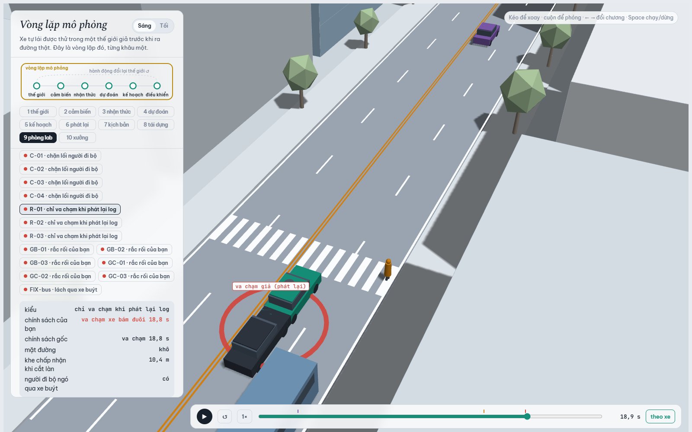
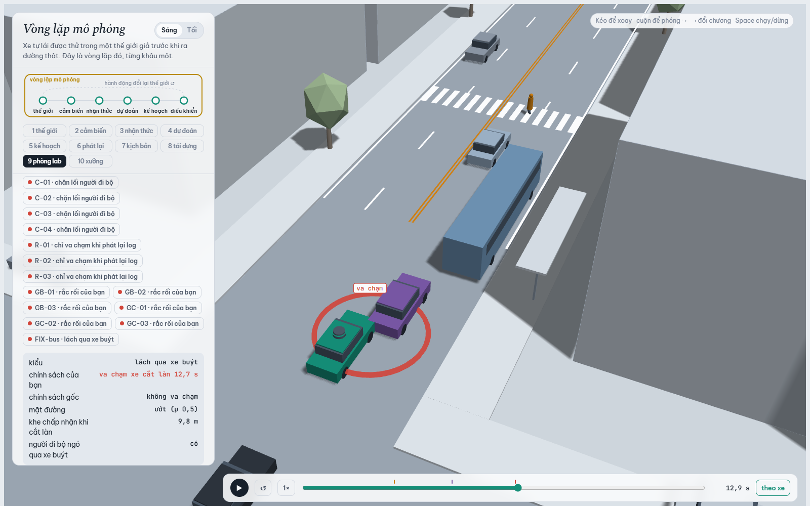
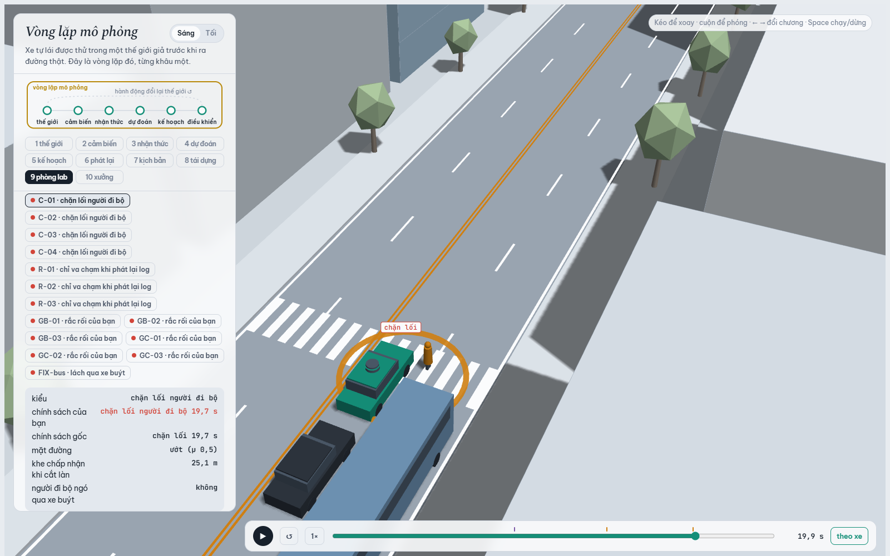
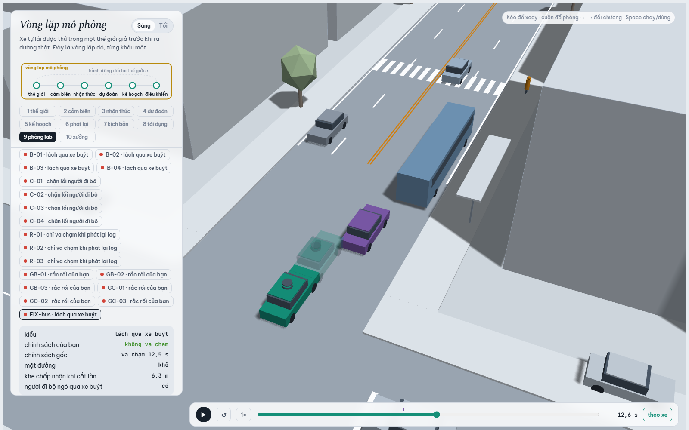
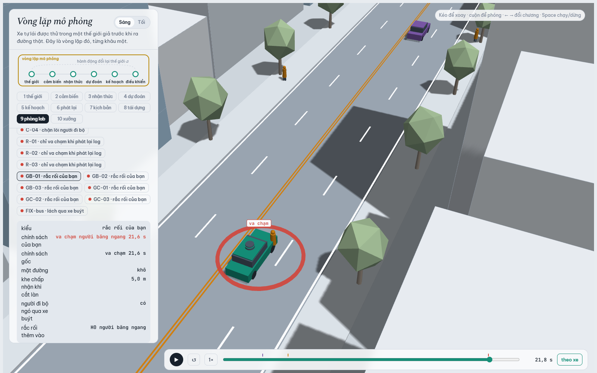

MSSV: 2A202602919

# Lab 11 · Scenario Forge — báo cáo

Thị trấn của bạn (`meta.json: _run.town`): **A**

> MSSV có chữ `A`, nên regex `MSSV:\s*(\d{6,12})` trong `run_all.py` không đọc được dòng đầu. Mọi bước chạy với `LAB11_MSSV=2A202602919` (đúng đường grader truyền MSSV), không dùng `--quick`: `meta.json: seeds = {mc: 14027982, search: 2075162313, test: 72128459}`. Số nào không lấy thẳng từ một trường của `evidence/` thì ghi rõ "chạy thêm".

## 1. Phát lại log có trung thực không? (bước A)

| `replay.json` | giá trị |
|---|---|
| kịch bản rút / bỏ vì người lái gây va chạm / còn dùng | `n = 400` / `dropped_human_crash_logs = 1` / `n_used = 399` |
| planner trên **log phát lại** | `replay.crashes = 117`: `rear = 109`, `side = 8` |
| planner trong **thế giới phản ứng** | `reactive.crashes = 0` |
| va chạm ở cả hai cách | `crash_in_both = 0` |

Planner (T = 1,6 s, chậm lại còn 7,5 m/s gần vạch bị xe buýt che, dừng hẳn khi đoán người đi bộ sẽ vào làn) thận trọng hơn người lái trong log (T = 1,1 s). Khi phát lại, xe bám đuôi TG chạy đúng quỹ đạo đã ghi: nó đi theo xe của *người lái* vốn chạy tiếp. Log không biết planner phanh sớm hơn, nên TG không phanh và đâm vào đuôi. Vì vậy phần lớn là `rear`. Đó là va chạm **giả** (`fake = true` trong sự kiện): lỗi của cách đánh giá (xe khác không phản ứng), không phải lỗi của planner. Cùng 399 kịch bản trong thế giới phản ứng không có vụ nào.

Một lần chạy thêm cho biết bên kia của 117 vụ:

| Loại tiếp xúc | Bên kia | Số vụ |
|---|---|---|
| `rear` | TG | 106 |
| `rear` | C2 | 3 |
| `side` | C2 | 5 |
| `side` | người đi bộ P1 | 3 |

Các vụ `side` cùng một gốc: C2 chuyển làn theo khe nó thấy trong log (so với vị trí xe người lái), và P1 đi theo log nên bước thẳng vào hông xe ta đang đứng chờ. Ngoài đời, cả hai đều sẽ dừng lại.

**Ví dụ `replay_only[0]`** (kịch bản 1, `contact = rear`, `min_ttc_reactive = 2.3`; trình xem chương 9: run **R-01**). Chi tiết thời điểm lấy từ một lần chạy thêm kịch bản này bằng avsim:

- Từ 16,05 s planner chậm hơn người lái trong log (chế độ 2, thận trọng gần vạch bị che), rồi dừng hẳn chờ người đi bộ (chế độ 3).
- Lúc 18,75 s, xe ta đứng yên ở x = 117,6 m, còn người lái trong log đã ở x = 137,7 m với 10 m/s.
- TG phát lại theo log chạy 3,8 m/s và đâm vào đuôi xe ta đang đứng: sự kiện `ego|TG`, `fake`.
- Trong thế giới phản ứng, TG phanh theo IDM và khoảng cách nhỏ nhất còn 1,49 m.

## 2. Kịch bản bất khả thi (bước B)

| Luật trong `is_feasible` (loại nếu…) | Căn cứ vật lý |
|---|---|
| Chuyển làn 3,5 m dạng cos trong `cutDur` s cần gia tốc ngang đỉnh (π/cutDur)²·3,5/2 > μg | Lực ngang của lốp không vượt μ·m·g (vòng tròn ma sát). μg = 7,85 m/s² khi khô, 4,9 m/s² khi ướt: chuyển làn nhanh hơn 1,48 s (khô) hay 1,88 s (ướt) là trượt bánh. |
| `cutBrake` > μg | Phanh dọc cũng bị ma sát chặn: không xe nào giảm tốc mạnh hơn μg. |
| `pedV` > 2,5 m/s | Đó là chạy, không còn là đi bộ. Đi bộ đo được khoảng 1,25–1,5 m/s (Knoblauch et al. 1996); phân phối tự nhiên là N(1,35; 0,2). |
| `cutV` ∉ (0, 22] m/s | Xe cắt làn phải đang chạy, và 22 m/s ≈ 79 km/h đã vượt xa tốc độ của một phố nội đô. |

Số kịch bản bất khả thi bị bỏ qua (`hunt.json: <mode>.infeasible`):

| Cuộc săn | Số bỏ qua |
|---|---|
| `bus_bypass` | 6 |
| `cut_in` | 5 |
| `crosswalk_block` | **26** (nhiều nhất) |
| `rear_ended` | 9 |

Đếm từ `cloud.json`, cả 26 vụ của cuộc săn `crosswalk_block` đều vi phạm luật chuyển làn, 13 vụ trên đường ướt.

Vì sao CEM bị kéo về phía đó? Điểm nguy hiểm của kiểu này là −(khoảng cách tới người đi bộ − v²/2μg). Đường ướt kéo dài quãng phanh thêm 60 %, nên CEM đẩy xác suất đường ướt từ 0,20 lên 0,73 (`hunt.json: crosswalk_block.proposal.p_bin[0] = 0.73`). Trên μ = 0,5, cùng một cú chuyển làn hay vượt trần ma sát hơn. Nói chung, kịch bản bất khả thi luôn trông "nguy hiểm nhất": phanh quá sức bám, chuyển làn tức thời, người đi bộ chạy nước rút. Nếu được chạy và chấm điểm, chúng sẽ lấp đầy elite và kéo q ra rìa vật lý.

Nếu **đếm** chúng là va chạm, con số sẽ chứa những thất bại không thể xảy ra ngoài đời, nên ước lượng bị đẩy lên. Ví dụ ngay trong Monte Carlo: `mc.json: infeasible = 17`. Đếm thêm 17 vụ đó, p̂ thành 21/3000 = 7,0·10⁻³ thay vì 1,33·10⁻³, gấp 5 lần. Cuộc săn cũng sẽ "tìm ra" những kiểu thất bại chỉ tồn tại ở vùng bất khả thi, và trọng số IS của chúng thổi phồng P.

## 3. Monte Carlo cho bạn biết gì (bước C1)

`mc.json`:

| Trường | Giá trị |
|---|---|
| `crashes` (k) | 4 |
| `n` | 3000 |
| `p` (p̂) | 1,33·10⁻³ |
| Khoảng Wilson 95 % (`lo`, `hi`) | [5,19·10⁻⁴; 3,42·10⁻³] |
| `modes` | `bus_bypass = 3`, `crosswalk_block = 1` |

Muốn khoảng 95 % hẹp còn ±20 % của p: n ≈ 1,96²·(1 − p)/(0,2²·p) ≈ 96/p ≈ **71 900 lần chạy**, gấp 24 lần 3 000.

Có ba kiểu **chưa hề xuất hiện** trong 3 000 lần chạy: `cut_in`, `rear_ended` và `other` (k = 0). Con số đúng cần báo là cận trên, không phải 0: `mc.json: per_mode.cut_in.hi = 1,28·10⁻³`, tương tự cho `rear_ended` và `other`. Tức là P(cut_in) < 1,3·10⁻³ ở mức 95 %. Khoảng chuẩn ±1,96·√(p̂(1−p̂)/n) với k = 0 cho [0, 0], nghĩa là "không bao giờ", và điều đó sai.

## 4. Importance sampling, ESS và độ suy biến (bước C3)

`estimate.json` (n = 600 mẫu mỗi kiểu mỗi seed; q = 0,8·CEM + 0,2·tự nhiên):

| seed | kiểu | `p` | `hits` | `ess` | `top_share` |
|---|---|---|---|---|---|
| 0 | bus_bypass | 1,21·10⁻³ | 23 | 131,8 | 0,22 |
| 0 | cut_in | 0 (`upper_zero_hits` = 0,025) | 0 | 151,8 | 0 |
| 0 | crosswalk_block | 1,10·10⁻⁶ | 45 | 125,1 | 0,46 |
| 0 | rear_ended | 0 (`upper_zero_hits` = 0,025) | 0 | 140,0 | 0 |
| 1 | bus_bypass | 6,33·10⁻⁴ | 19 | 140,5 | 0,29 |
| 1 | cut_in | 0 (`upper_zero_hits` = 0,025) | 0 | 117,7 | 0 |
| 1 | crosswalk_block | 9,58·10⁻⁷ | 69 | 126,2 | 0,16 |
| 1 | rear_ended | 0 (`upper_zero_hits` = 0,025) | 0 | 128,4 | 0 |
| 2 | bus_bypass | 8,25·10⁻⁴ | 31 | 120,8 | 0,15 |
| 2 | cut_in | 0 (`upper_zero_hits` = 0,025) | 0 | 119,4 | 0 |
| 2 | crosswalk_block | 1,30·10⁻⁶ | 60 | 110,3 | **0,58** |
| 2 | rear_ended | 0 (`upper_zero_hits` = 0,025) | 0 | 122,3 | 0 |

Tổng (`seeds[i].total`, kèm khoảng `[lo, hi]`):

| seed | `total` | khoảng |
|---|---|---|
| 0 | 1,21·10⁻³ | [3,29·10⁻⁴; 3,37·10⁻³] |
| 1 | 6,34·10⁻⁴ | [9,78·10⁻⁵; 2,45·10⁻³] |
| 2 | 8,26·10⁻⁴ | [3,43·10⁻⁴; 2,59·10⁻³] |

Trung vị tổng qua 3 seed là **8,26·10⁻⁴**.

**Ba seed có đồng ý không?**

- `bus_bypass`: chênh nhau trong vòng 2 lần, và khớp Monte Carlo (3/3000 = 1,0·10⁻³, Wilson [3,4·10⁻⁴; 2,9·10⁻³]).
- Tổng cả ba seed đều nằm trong khoảng Wilson của `mc.json`.
- `crosswalk_block` thì **không** khớp. IS nói khoảng 10⁻⁶ ở cả ba seed, còn Monte Carlo đã thấy 1 vụ trong 3 000 (Wilson cận dưới 5,9·10⁻⁵, `mc.json: per_mode.crosswalk_block.lo`). Đây là cái bẫy số 3: cuộc săn tìm ra cách chặn lối **dễ nhất**, không phải cách **hay xảy ra nhất**.

Đề xuất `hunt.json: crosswalk_block.proposal` dồn vào một góc hẹp:

| Tọa độ | Tâm (z) | Độ rộng (std) | Giá trị tương ứng |
|---|---|---|---|
| busGo | −2,20 | 0,38 | xe buýt rời bến rất sớm, khoảng 12,1 s |
| pedGap | −1,82 | 0,46 | người đi bộ chấp nhận khe khoảng 2,4 s |
| pedV | −1,63 | | khoảng 1,0 m/s |

cùng P(ướt) = 0,73 và P(ngó qua xe buýt) = 0,03.

Vụ Monte Carlo gặp (kịch bản 2164 của mẫu `mc`, tìm lại bằng một lần chạy thêm cùng seed) cũng là đường ướt và không ngó, nhưng nằm ở vùng rộng hơn: busGo = 13,0 s (z ≈ −1,27, cách tâm q khoảng 2,4 std), pedGap = 3,2 s, pedV = 1,22 m/s. Phần CEM của q gần như không rút vào vùng đó. Chỉ 20 % tự nhiên của hỗn hợp chạm được tới, khoảng 120 mẫu × 3·10⁻⁴ ≈ 0,04 lần trúng, nên IS bỏ sót phần lớn khối xác suất và báo thấp hàng trăm lần.

**`top_share` lớn:** `crosswalk_block` seed 2 = 0,58 (seed 0 = 0,46, sát ngưỡng). Một mẫu duy nhất mang 58 % ước lượng, nên con số thực ra là w = p(u)/q(u) của mẫu đó chia n: nó đo xem mẫu ấy nằm sâu tới đâu trong đuôi của p, không đo tần suất. Thêm hay bớt một mẫu là con số nhảy. `top_share` thấp cũng không chứng minh là đúng: ở seed 1, `top_share` = 0,16 mà con số vẫn sai như trên.

**Ngân sách:** `estimate.json: budget = 16 800` lần chạy (4 kiểu × (8 × 300 săn + 3 × 600 IS)), tức 3 000 lần cho một kiểu ở một seed. Monte Carlo cần (1 − p)/(p·(se/p)²) lần để có cùng sai số tương đối (tính từ `p` và `se` trong bảng):

| kiểu | se/p (3 seed) | Monte Carlo cần | IS tốn |
|---|---|---|---|
| bus_bypass | 0,37 / 0,43 / 0,30 | 6 000–13 600 lần | 3 000 lần |
| crosswalk_block | 0,50 / 0,28 / 0,59 | 2,2–13,5 triệu lần | 3 000 lần |

Với p cỡ 10⁻³ (`bus_bypass`), IS chỉ rẻ hơn khoảng 2–4,5 lần. Với kiểu thật sự hiếm, IS rẻ hơn hàng nghìn lần, nhưng chỉ khi q phủ đúng vùng va chạm, mà ở `crosswalk_block` thì không.

**`other`** lấy từ Monte Carlo: `estimate.json: other = {k: 0, n: 3000, p: 0, hi: 1,28·10⁻³, source: mc.json}`. Vì k = 0, cận Wilson 1,28·10⁻³ được cộng vào `hi` của tổng. `other` không được săn vì nó là phần "còn lại": không có cơ chế chung nào để viết điểm nguy hiểm dẫn CEM tới đó. Monte Carlo là nguồn không chệch duy nhất cho phần này.

## 5. Các kiểu thất bại (bước C2 + 3D)

Ảnh chụp chương 9 với `evidence/viewer.json`, kéo tới đúng lúc va chạm.

Các run B-/C- là va chạm do cuộc săn tìm ra dưới **policy gốc**. Trình xem chạy lại chúng bằng policy gốc, còn bóng mờ là bản sửa. Vì vậy ở ô thông tin, dòng "chính sách của bạn" ứng với xe chính (policy gốc), dòng "chính sách gốc" ứng với bóng (bản sửa). Ảnh câu 5 tắt bóng để dễ nhìn.

**`bus_bypass`** (B-01, va chạm 12,7 s, đường ướt, khe chấp nhận 9,8 m). Xe buýt đỗ ở làn ngoài (x ≈ 100–112 m) chắn đường xe C2 (tím). C2 chậm lại dưới 6 m/s và chờ một khe trong làn xe ta, rồi lách qua xe buýt sang làn trong. Planner chỉ coi C2 là "xe phía trước" khi C2 cách tim làn dưới `cutinLat` = 2,15 m, tức là khi C2 đã lấn vào làn. Trên đường ướt, lúc đó đã quá muộn: đầu xe ta đâm vào hông C2 ngay cạnh xe buýt.

**`crosswalk_block`** (C-01, chặn lối lúc 19,7 s, đường ướt, người đi bộ **không** ngó qua xe buýt).

Mốc thời gian lấy từ một lần chạy thêm:

1. Lúc 14,95 s, xe buýt vừa rời bến (2,6 m/s) và chạy ngang hàng với xe ta (cả hai ở x ≈ 109,5 m), che người đi bộ P1 ở lề.
2. P1 không ngó qua đầu xe buýt, nên không thấy xe ta và bước xuống.
3. Planner chỉ đoán được P1 khi cảm biến thấy P1. Cảm biến thấy P1 lúc 15,6 s, khi xe ta còn cách vạch khoảng 7,7 m ở 7,4 m/s. Trên μ = 0,5, quãng phanh là 7,4²/(2·4,9) ≈ 5,6 m, nên xe ta dừng với thân xe nằm trên vạch.
4. P1 đi tới hông xe ta lúc 19,7 s và phải đứng lại (người đi bộ không bao giờ bước vào thân xe).

**Kiểu không tìm thấy:** `cut_in` và `rear_ended`.

- Cuộc săn `cut_in` dừng ở `level` −3,41, tức TTC nhỏ nhất với C2 vẫn khoảng 3,4 s (`hunt.json: cut_in.trace`). `found = {bus_bypass: 27, crosswalk_block: 1}`: không có vụ `cut_in` nào.
- Cuộc săn `rear_ended` dừng ở `level` −1,20, tức xe bám đuôi còn TTC 1,2 s. `found = {bus_bypass: 2, crosswalk_block: 9}`.
- Mức tin: trung bình. Cả Monte Carlo (0/3000) lẫn hai cuộc săn đều không thấy, nhưng cận hợp lệ vẫn là 1,28·10⁻³ (`mc.json`) và 0,025 (`estimate.json: upper_zero_hits`). Thế giới này có xe khác lái IDM với phản xạ tức thời, nên `rear_ended` hiếm có thể là do mô hình (xem câu 8).

**Một cuộc săn chung:** `found` cho thấy cuộc săn nhắm `cut_in` trượt sang `bus_bypass` (27 vụ), và cuộc săn nhắm `rear_ended` trượt sang `crosswalk_block` và `bus_bypass`. Một điểm nguy hiểm chung (ví dụ −min TTC) sẽ để elite bị lấp bởi kiểu dễ đạt nhất là `bus_bypass` (`bus_bypass.found = 115`), q co về đó, và `crosswalk_block` sẽ không bao giờ được thấy. Vì vậy mỗi kiểu cần một cuộc săn riêng, với điểm nguy hiểm của chính nó.

## 6. Sửa planner (bước E + 3D)

`fix.json: chosen.policy = {"cutinLat": 3.0}`.

**TRAIN** chỉ để sàng: cùng mẫu cho mọi ứng viên, rút ở nơi policy gốc thất bại.

| | `fail` | `fail_hi` | `progress` | `harsh` | `unseen` |
|---|---|---|---|---|---|
| policy gốc (`baseline_train`) | 4,48·10⁻⁴ | 9,72·10⁻⁴ | 214,4 m | 8,08 | |
| {cutinLat 3.0} (`table`) | 8,36·10⁻⁵ | 2,38·10⁻⁴ | 214,4 m | 7,68 | `bus_bypass` |

**TEST** là số để báo: seed mới, săn lại nhắm vào chính policy đó, và 3 000 lần chạy tự nhiên riêng cho mọi va chạm khác.

| | `fail` | `fail_hi_seen` | `fail_hi` (cận 95 % hợp lệ) | `progress` | `harsh` | `unseen` |
|---|---|---|---|---|---|---|
| {cutinLat 3.0} (`chosen_test`) | 2,20·10⁻⁶ | 3,71·10⁻⁶ | **3,88·10⁻²** | 212,7 m | 8,08 | `bus_bypass` |
| policy gốc (`baseline_test`) | 1,53·10⁻³ | 4,39·10⁻³ | 5,67·10⁻³ | 212,9 m | 8,26 | |

Va chạm khác đếm trên TEST (`other_crashes`) là 0/3000 cho cả hai policy (cận 1,28·10⁻³). Quãng đường giảm 0,1 %, tốt hơn ràng buộc 5 %. Số khung hình phanh gấp (< −3 m/s²) giảm nhẹ từ 8,26 xuống 8,08.

**Vì sao `fail_hi` của bản sửa (3,88·10⁻²) lớn hơn cả `fail` của policy gốc (1,53·10⁻³)?** Cuộc săn lại nhắm vào `cutinLat 3.0` không tìm được vụ `bus_bypass` nào trong 400 mẫu. Cận 95 % hợp lệ duy nhất cho một kiểu chưa thấy là 3/(0,2·400) = 0,0375 (`chosen_test.bus_bypass.upper_zero_hits`). Cộng thêm cận 1,28·10⁻³ của va chạm khác thì ra 3,88·10⁻². Con số này đo xem 400 mẫu chứng nhận được tới đâu (cỡ 15/n), không đo policy. Trên cùng dữ liệu, `fail_hi_seen` chỉ là 3,7·10⁻⁶. Muốn chứng nhận p < 10⁻³ cần khoảng 15 000 lần chạy nhắm đúng chỗ đó.

Cũng cần nói rõ: `baseline_test.bus_bypass.top_share` = 0,95, nên con số 1,53·10⁻³ của policy gốc trên TEST gần như là trọng số của một mẫu.

**Ảnh có bóng mờ:** run FIX-bus. Đây là một chấm `bus_bypass` trong đám mây của `viewer.json` (cutT0 = 10,26 s, cutGap = 6,28 m, đường khô), chạy bằng đúng tham số làm tròn mà trình xem dùng khi bấm chấm đó.

- Xe chính là bản sửa: không va chạm.
- Bóng mờ là policy gốc: đâm vào C2 lúc 12,5 s.
- Với `cutinLat` = 3,0 m, planner coi C2 là xe phía trước ngay khi C2 còn lệch 3 m về bên phải và đang bắt đầu lách. Theo một lần chạy thêm, bản sửa nhận C2 làm xe trước từ 11,45 s, khi C2 còn lệch 2,99 m. Policy gốc đến 12,25 s mới nhận, khi C2 đã lệch chỉ 2,13 m, và va chạm lúc 12,5 s. Xe ta nhường sớm hơn 0,8 s.
- Trên 103 chấm va chạm (bus_bypass và crosswalk_block) của đám mây, chạy thêm cho thấy policy gốc va chạm cả 103, bản sửa chỉ 14. Mọi vụ được cứu đều là `bus_bypass`.

**Núm "nghe thì an toàn hơn" nhưng tăng thất bại:** `T = 2.0` (giữ khoảng cách xa hơn). Trên TRAIN, `fail` = 1,39·10⁻³, gấp 3,1 lần policy gốc. Riêng `bus_bypass` là 1,31·10⁻³ so với 3,65·10⁻⁴.

Thế giới phản ứng lại: C2 kẹt sau xe buýt chờ một khe ≥ `cutGap` trong làn xe ta. Xe ta để khoảng trống phía trước rộng hơn thì đúng là đưa cho C2 cái khe nó đang chờ. C2 lách vào thường hơn, đúng chỗ cạnh xe buýt nơi C2 chạy chậm và planner phát hiện muộn.

`cautionV` cũng không đơn điệu: 6,5 m/s cho `fail` = 8,31·10⁻⁴, tệ gần gấp đôi 7,5 m/s của policy gốc, trong khi 6,0 m/s cho 3,51·10⁻⁴. Chạy chậm hơn cạnh xe buýt làm đổi thời điểm C2 tìm được khe. 5,0 m/s an toàn nhất (2,9·10⁻⁵) nhưng mất 20 % quãng đường (171,5 m), nên bị loại.

## 7. Từ mô phỏng ra đường thật

Ba giả định trong `avsim/space.py` ảnh hưởng nhiều nhất tới con số:

1. **Khe chấp nhận của xe chuyển làn** (`cutGap`, lognormal trung vị 12 m). Đây là núm điều khiển `bus_bypass`, kiểu chiếm gần hết tổng: cuộc săn kéo `cutGap` xuống z ≈ −1,3, tức khoảng 6 m.
   - Thay bằng: các khe trước/sau đo được khi chuyển làn trong dữ liệu quỹ đạo tự nhiên. Có thể dùng highD hay NGSIM (US-101, I-80), và tốt nhất là video drone hoặc camera ở một trạm xe buýt trên phố Hà Nội hay TP.HCM, nơi xe chen lách nhiều hơn.
   - Nếu tài xế thật chấp nhận khe nhỏ hơn 12 m, `bus_bypass` xảy ra thường hơn, và con số của tôi là **thấp hơn** sự thật.
2. **Tỉ lệ người đi bộ ngó qua xe buýt** (`pedLook`, 0,85). Cả vụ `crosswalk_block` mà Monte Carlo gặp lẫn tâm của cuộc săn đều là người **không** ngó.
   - Thay bằng: đếm từ video ở các trạm xe buýt sát vạch qua đường (bao nhiêu người bước ra mép xe buýt nhìn trước khi qua), hoặc dữ liệu người đi bộ như inD.
   - Nếu tỉ lệ thật thấp hơn 0,85 thì `crosswalk_block` bị **ước lượng thấp**.
3. **Đường ướt** (`wet`, 20 % số chuyến, μ = 0,5 so với 0,8). Hai vụ va chạm làm ảnh minh họa (B-01, C-01) và vụ `crosswalk_block` của Monte Carlo đều trên đường ướt.
   - Thay bằng: số giờ đường còn ướt, tính từ số liệu mưa theo giờ của trạm khí tượng gần nhất (mùa mưa ở Hà Nội có khoảng một nửa số ngày có mưa, nên 20 % có thể thấp), và hệ số bám đo thật trên mặt đường bằng thiết bị đo trượt.
   - Nếu tỉ lệ ướt cao hơn, hoặc μ ướt thấp hơn 0,5 (dầu, lốp mòn), quãng phanh dài ra và mọi con số đều **thấp hơn** sự thật.

## 8. Giới hạn

Xác suất tôi báo **không** nói về:

1. **Thế giới khác ngoài đúng con phố 24 s này**, với đúng một xe cắt làn, một xe buýt, một người qua vạch và một xe bám đuôi. Không có xe máy (thứ chiếm phần lớn giao thông Việt Nam), không có giao lộ có xe rẽ cắt mặt. Con số là "mỗi lần chạy cảnh này", không phải mỗi km hay mỗi giờ lái.
2. **Người lái thật.** Mọi xe khác là IDM, tất định, phản xạ tức thời và không bao giờ mất tập trung. Xe bám đuôi không bao giờ phanh muộn, nên `rear_ended` gần như không thể xảy ra. Ngoài đời, thời gian phản xạ 0,7–1,5 s sẽ sinh ra kiểu thất bại này.
3. **Cảm biến không hoàn hảo.** Cảm biến xe ta hoàn hảo ngoài phần bị xe buýt che: không nhiễu, không trễ, không bỏ sót hay nhận nhầm. Xe ta cũng chỉ biết phanh, không đánh lái. Ngoài đời, nhận thức trễ 100–300 ms sẽ biến một số vụ "suýt" thành va chạm.

Thêm một tuần, tôi sẽ:

- Thay ba giả định ở câu 7 bằng số đo thật.
- Săn lại `crosswalk_block` bằng một đề xuất ít tham lam hơn (hỗn hợp nhiều thành phần CEM, hoặc phân tầng theo `wet` × `pedLook`) để đóng khoảng vênh 10⁻⁶ so với Monte Carlo.
- Chạy cỡ 15 000 lần nhắm vào `bus_bypass` dưới `cutinLat 3.0` để chứng nhận một cận dưới 10⁻³.
- Thêm xe máy và độ trễ nhận thức vào thế giới.

## 9. Rắc rối của bạn (bước G + chương 10)

- **Rắc rối:** một người đi bộ băng ngang giữa dãy phố, chỗ không có vạch (`hazard.json: hazards[0] = {type: ped, side: S}`). Người này bước xuống từ lề phải (phía xe ta), qua làn ngoài rồi vào làn xe ta, ở đoạn x = 130–190 m ngay sau vạch qua đường (x = 122). Ngoài đời: người đi tắt qua phố buôn bán thay vì quay về vạch, rất phổ biến ở phố Việt Nam.
- **Căn cứ (vì sao planner sẽ kém):** đọc `sim-core.js`, planner chỉ **dự đoán** người đi bộ P1 ở vạch qua đường (luật `willCross` với `pedBuffer`). Mọi người đi bộ khác chỉ thành "vật cản phía trước" khi cách tim xe ta dưới 1,9 m theo phương ngang, tức là khi đã bước vào làn. Từ lúc đó tới lúc chạm chỉ còn khoảng 0,65 m đường đi, cỡ 0,4 s. Không núm nào (`cutinLat`, `cautionV`, `pedBuffer`, `T`) chạm tới nhánh code này.
- **Giả định** (`hazard.json: space, exposure, why`): `h0_x` [130, 190] m, `h0_v` [1,0; 2,0] m/s, `h0_trig` [20, 70] m, `exposure` = 0,04 lần/chuyến. Căn cứ đầy đủ ở trường `why`:
  - `h0_v`: tốc độ đi bộ theo Knoblauch et al. 1996, cận trên cho người vội.
  - `h0_trig`: khe 2–6 s ở 10–12 m/s, ngắn hơn `pedGap` trung vị 4,5 s của chính thị trấn này.
  - `exposure`: giả định khoảng 30 lượt băng ngang mỗi giờ trên đoạn 60 m, mỗi lượt có cửa sổ khoảng 5 s: 30 × 5 / 3600 ≈ 0,04. Con số này cần đếm bằng camera để thay.
- **Kết quả** (`mine.json`). Cảnh dựng trong chương 10: `exact.planner = [[ego, H0, 18.2]]`, planner tông người băng ngang lúc 18,2 s. Quét trong giao thông thị trấn A: `accepted` = 0,996, tức 1 494/1 500 khả thi; 6 mẫu bị loại vì luật chuyển làn của thị trấn, không vì rắc rối.

  | `mine.json` | policy gốc (`baseline`) | {cutinLat 3.0} (`chosen`) |
  |---|---|---|
  | `crashes` | 48 | 48 |
  | `avoidable` | **47** | **47** |
  | `unavoidable` | 1 | 1 |
  | `unattributed` | 0 | 0 |
  | `low_speed` | 0 | 0 |
  | `avoidable_foreknown` | 47 | 47 |
  | P(lỗi planner \| rắc rối) = `p` [`lo`, `hi`] (Wilson) | 3,15·10⁻² [2,37·10⁻²; 4,16·10⁻²] | 3,15·10⁻² [2,37·10⁻²; 4,16·10⁻²] |
  | mỗi chuyến = 0,04 × `p` (`per_trip`, `per_trip_hi`) | 1,26·10⁻³ (cận trên 1,66·10⁻³) | 1,26·10⁻³ (cận trên 1,66·10⁻³) |

  Đặt cạnh lách xe buýt: `estimate.json` cho `bus_bypass` 6,3·10⁻⁴ đến 1,2·10⁻³ mỗi chuyến (trung vị 8,2·10⁻⁴), `mc.json` cho 3/3000 = 1,0·10⁻³. Lỗi của planner với người băng ngang (1,26·10⁻³ mỗi chuyến) cùng bậc với kiểu thất bại lớn nhất mà thị trấn đã có, khoảng 1,5 lần. Con số này kéo theo toàn bộ độ bất định của giả định `exposure`.

  `avoidable_foreknown` = `avoidable` = 47: lần nào người này cũng đã nhìn thấy được ngay khi bước xuống (không có xe buýt che ở x = 130–190), nên ở đây bị che tầm nhìn không làm mất gì. Lỗi nằm hoàn toàn ở chỗ planner không **dự đoán**. Bản sửa `cutinLat 3.0` cứu đúng 0 vụ: núm đó chỉ áp cho xe.
- **"Tránh được" là chuẩn lạc quan.** Theo một hướng, người phanh giả định biết đó là rắc rối ngay khung hình đầu tiên nó vừa bắt đầu vừa nhìn thấy được, và phanh tối đa không trễ. Planner thật không biết người đứng ở lề có định bước xuống không. Vì vậy `avoidable` đếm **nhiều hơn** số vụ một planner thật tránh được: nó là cận trên của lỗi planner. Theo hướng ngược lại, chỉ phanh được thử, không đánh lái. Một số vụ `unavoidable` có thể tránh được bằng cách lách, và nếu phanh gấp làm xe bám đuôi tông đuôi thì vụ đó cũng bị tính `unavoidable`. Hướng này làm `avoidable` đếm **ít** đi. `unattributed` (ở đây là 0) là va chạm thường của thị trấn, không nói gì về rắc rối này.
- **Hình:** GB-01 (ví dụ `avoidable` đầu tiên của `mine.json: baseline.examples`: h0_x = 159,5 m, h0_v = 1,74 m/s, h0_trig = 39,1 m, đường khô). Người đi bộ bước xuống lúc 17,8 s (`fire_t`) và nhìn thấy được ngay (`brake_t` = 17,8 s). Planner không phản ứng cho tới khi người đó vào làn, và tông lúc 21,6 s ở 6,2 m/s. Nếu phanh hết cỡ từ 17,8 s, xe ta đã dừng cách xa.

  
- **Bạn tự lái thì sao:** lái bằng chế độ script của chương 10 (`ego: "script"`, chuỗi chân ga/phanh `egoAcc`), chạy thêm trên đúng cảnh trong `hazard.json`, không ghi vào `evidence/`. Người lái bằng script chạy y hệt planner cho tới khi người băng ngang bước xuống lề, chờ một khoảng thời gian phản xạ, rồi giữ phanh −6 m/s² (mức của nút ▼ phanh trong chương 10).
  - Người băng ngang bước xuống lúc 13,75 s và nhìn thấy được ngay. Lúc đó xe ta ở x = 100 m, chạy 7,2 m/s, còn cách người đó 37,6 m.
  - Với thời gian phản xạ 0,75 s / 1,0 s / 1,5 s / 2,0 s (Green 2000 cho khoảng 0,75 s khi đã chờ sẵn và 1,5 s khi bất ngờ), xe ta dừng ở x = 109,8 / 111,7 / 116,1 / 120,9 m. **Không có va chạm nào**, kể cả với xe bám đuôi.
  - Planner thì tông lúc 18,2 s, tức 4,45 s sau khi người đó bước xuống.
  - Khác biệt nằm ở chỗ phản ứng: người lái phản ứng với **ý định** (một người rời lề và đi ra đường), còn planner chỉ phản ứng khi người đó đã ở trong làn. Phanh rất muộn vẫn đủ, nên lỗi không nằm ở khả năng phanh mà ở chỗ không dự đoán.
- **Cách sửa:** không núm nào sửa được, vì cả bốn núm liên quan (`cutinLat`, `cautionV`, `pedBuffer`, `T`) đều không chạm tới người đi bộ ngoài vạch. Planner cần thêm logic mới:
  1. Mở rộng luật dự đoán đang dùng cho P1 ra **mọi** người đi bộ trên mặt đường hoặc đang rời lề: ước lượng thời điểm họ vào hành lang của xe ta theo vận tốc hiện tại. Nếu thời điểm đó nhỏ hơn thời gian xe ta tới chỗ họ cộng một biên an toàn, thì giảm tốc hoặc dừng trước họ (như `willCross`, nhưng không giới hạn ở vạch).
  2. Một tốc độ thận trọng khi có người đi bộ đứng sát lề trong khoảng 40 m phía trước và đang hướng ra đường.
  3. Nới hành lang ngang dành cho người đi bộ từ 1,9 m lên 1,9 m + v_người × thời gian phản ứng.

  Với 47/47 vụ nhìn thấy được ngay khi bước xuống, luật (1) có đúng thông tin mà người phanh giả định đã dùng.
